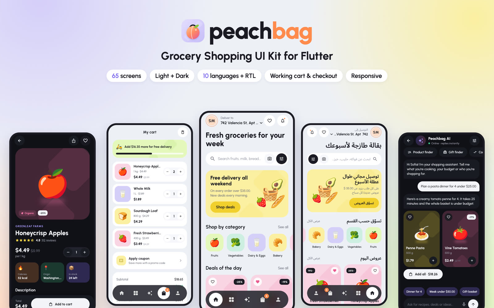

# Peachbag – Grocery Shopping UI Kit for Flutter

A grocery shopping app UI kit made with Flutter: 65 connected screens, light and dark themes, 10 languages with Arabic right-to-left, and responsive layouts for phones, tablets and the web.

**▶ Try the live demo:** https://yaqoobdeveloper.github.io/Peachbag-Grocery-UI-Kit-in-Flutter/

**Get the full source code:** https://yaqoobdeveloper.com/ui-kits/peachbag-grocery-shopping-flutter-ui-kit

## Highlights

- 65 screens: onboarding, sign in, home, categories, search and filters, product, cart, checkout, orders and tracking, wishlist, shopping lists, stores and map, an AI shopping suite, profile and settings
- Working cart, coupons, wishlist and checkout demo
- 10 languages, including Arabic right-to-left, and a currency switcher
- Light and dark themes, switchable in the app
- Maps and illustrations painted in code: no map SDK, no API keys, no stock photos
- Android, iOS and web from one codebase

This repository holds the live demo only. The Flutter source code is available on yaqoobdeveloper.com.
